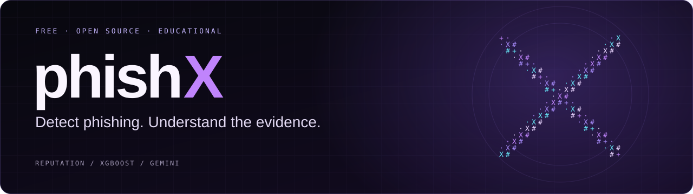
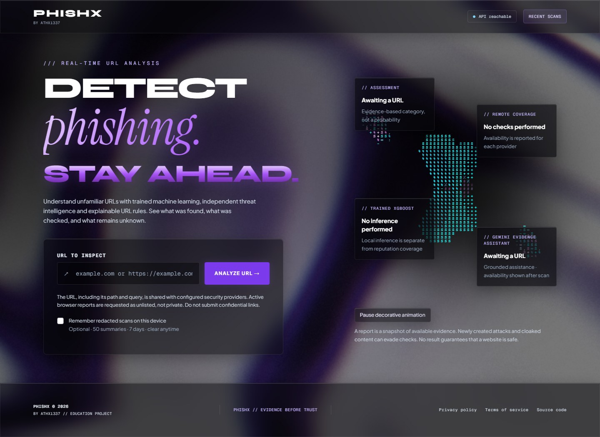
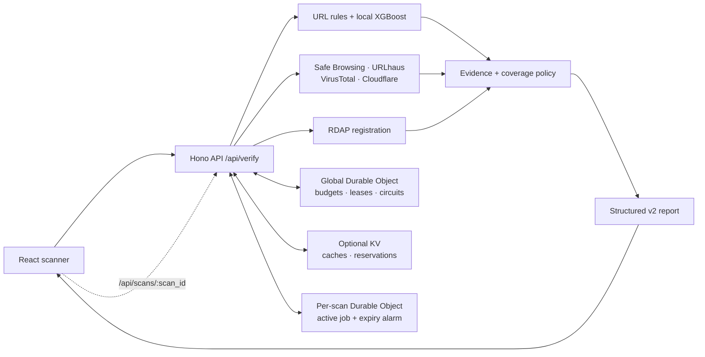

<div align="center">
  <a href="https://phish-x.vercel.app">
    
  </a>

  <h1>phishX</h1>
  <p><strong>Detect phishing. Understand the evidence.</strong></p>
  <p>A free, educational URL scanner combining threat intelligence, local machine learning,<br />and explainable signals in one clear report.</p>

  <p>
    <a href="https://github.com/athx1337/phishX/actions/workflows/ci.yml"></a>
    <a href="LICENSE"></a>
    <a href="https://nodejs.org/"></a>
    <a href="model/MODEL-CARD.md"></a>
  </p>

  <p>
    <a href="https://phish-x.vercel.app"><strong>Open the app ↗</strong></a>
    &nbsp; · &nbsp; <a href="docs/API.md">Read the docs</a>
    &nbsp; · &nbsp; <a href="https://github.com/athx1337/phishX/issues">Report an issue</a>
  </p>
</div>

<br />

<a href="https://phish-x.vercel.app"></a>
<p align="center"><sub>The production interface: animated waves, a typewriter heading, and the scanner at the center.</sub></p>

<p align="center">
  <a href="#why-phishx">Features</a> ·
  <a href="#read-the-result">Verdicts</a> ·
  <a href="#how-it-works">Architecture</a> ·
  <a href="#run-locally">Quick start</a> ·
  <a href="#verify-your-changes">Verification</a> ·
  <a href="#the-model-and-its-limits">Model</a> ·
  <a href="#privacy-by-design-and-by-choice">Privacy</a> ·
  <a href="#documentation">Docs</a>
</p>

## Why phishX

A useful scan explains what was observed, where the information came from, and which checks are still missing. phishX brings those details together without compressing uncertainty into a safety score.

| Capability | What you get |
| :--- | :--- |
| **Evidence you can inspect** | Four outcomes, attributed reasons, observation times, coverage, and explicit pending/error states. |
| **Trained local XGBoost** | A real URL-only model running inside the Worker: 69 features and 160 trees, with no separate Python inference service. |
| **Four remote sources** | Reputation from Google Safe Browsing, URLhaus and VirusTotal, plus active inspection from Cloudflare URL Scanner, each with its actual status and findings. |
| **Grounded Gemini assistance** | Gemini 2.5 Flash selects existing evidence IDs for an explanation. Production displays its completion or fallback status; it cannot override the verdict. |
| **An expressive interface** | Restored waves, typewriter/glitch text, ASCII X, floating glass panels, responsive reports, and pause/reduced-motion controls. |
| **Deliberate data handling** | Sensitive-link consent, opt-in redacted browser history capped at 50 entries/seven days, and short-lived active scan jobs. |

## Read the result

| Report label | Meaning |
| :--- | :--- |
| **Malicious URL** | Strong threat-intelligence evidence was found. Avoid interacting with the URL. |
| **Suspicious URL** | Deceptive structure, weaker or stale positive intelligence, or conflicting findings warrant caution. |
| **No known threats detected** | Sufficient fresh reputation checks found no known threat or warning. This is not a safety guarantee. |
| **Unable to determine** | Evidence is insufficient, unknown, unavailable, failed, or pending. |

A clean conclusion requires fresh results from at least two independent reputation sources for every requested protocol, with no warning or pending active inspection. Local model output does not count as remote coverage. Missing checks never become clean votes.

## How it works



The Worker contacts fixed provider endpoints rather than fetching arbitrary submitted pages. Cloudflare can perform remote active inspection; observed destinations receive bounded reassessment. Pending jobs return a polling path and timing, and each poll returns a complete updated report.

Production requires managed route limiters and a global Durable Object coordinator. Separate per-scan objects preserve canonical job state and delete it on a fixed deadline; optional KV supports caches and submission reservations. [Explore the API contract →](docs/API.md)

| Layer | Technology |
| :--- | :--- |
| Interface | React 19, Vite 7, Tailwind CSS, Motion, Three.js |
| API and runtime | TypeScript, Hono, Cloudflare Workers |
| Coordination and storage | Durable Objects, optional Workers KV, managed rate limits |
| Analysis | Local XGBoost, URL heuristics, RDAP, four remote providers |
| Explanation | Deterministic templates; optional Gemini 2.5 Flash evidence selection |
| Verification | Node test runner, Vitest, Playwright/axe, model parity, Prometheus rules |

```text
phishX/
├── frontend/         React interface and browser tests
├── backend-worker/   Worker routes, providers, policy, and coordination
├── shared/           Versioned report types and runtime validation
├── tests/            Contract, privacy, and monitor regressions
├── ml/               Reproducible training and model verification
├── model/            Active artifacts, evaluation, and model card
├── docs/             API, privacy, deployment, and research guides
└── ops/ + scripts/   Monitoring rules and verification tooling
```

## Run locally

Use **Node.js 24** (recommended; `.nvmrc` and CI), or Node **22.12+**, and npm. Python is needed only for training/pipeline work, not for running the app or serving the checked-in model.

### 1. Clone and install

```bash
git clone https://github.com/athx1337/phishX.git
cd phishX
npm ci --prefix backend-worker
npm ci --prefix frontend
```

Create fresh local configuration files:

```bash
cp backend-worker/.dev.vars.example backend-worker/.dev.vars
cp frontend/.env.example frontend/.env
```

<details>
<summary><strong>Windows PowerShell</strong></summary>

Use the same clone/install commands, then copy the templates with:

```powershell
Copy-Item backend-worker/.dev.vars.example backend-worker/.dev.vars
Copy-Item frontend/.env.example frontend/.env
```

</details>

### 2. Start both apps

In one terminal:

```bash
npm run dev:api
```

In a second terminal:

```bash
npm run dev:web
```

Open [localhost:5173](http://localhost:5173). The API runs at [localhost:8787](http://localhost:8787); `frontend/.env` sets `VITE_API_URL` for the frontend build.

Provider keys are optional for local development. Without them, ordinary URLs generally return **Unable to determine**, while URL rules or the local model can still raise warnings. `/api/ping` confirms reachability; it does not test provider health. The example enables `DEV_MODE` only for localhost and disables Gemini locally.

<details>
<summary><strong>Configure providers and runtime bindings</strong></summary>

| Setting or binding | Purpose |
| :--- | :--- |
| `GOOGLE_SAFE_BROWSING_API_KEY` | Safe Browsing v5 reputation checks |
| `URLHAUS_API_KEY` | Malware-distribution intelligence |
| `VIRUSTOTAL_API_KEY` | URL intelligence and domain metadata |
| `CLOUDFLARE_ACCOUNT_ID`, `CLOUDFLARE_API_TOKEN` | URL Scanner v2; Scanner read/write permissions required |
| `SCAN_CACHE` | Optional KV for cached observations/reports and active-scan reservations |
| `SCAN_COORDINATOR`, `REQUIRE_COORDINATOR` | Production admission, concurrency, circuits, metrics, and per-scan job state |
| `SCAN_RATE_LIMITER`, `POLL_RATE_LIMITER` | Required managed creation/poll budgets |
| `CLIENT_ID_SECRET`, `METRICS_TOKEN` | Independent client-identity HMAC and protected metrics secrets |
| `ALLOWED_ORIGINS` | Exact frontend origins accepted by CORS |
| `CACHE_CONFIG_VERSION` | Cache generation; increment after provider/policy changes |
| `GEMINI_ENABLED`, `GEMINI_API_KEY`, `GEMINI_MODEL` | Optional bounded evidence selection; production uses `gemini-2.5-flash` |

Keep local credentials in ignored `.dev.vars` files. Set production credentials through Wrangler secret bindings, for example from `backend-worker/`:

```bash
npx wrangler secret put GOOGLE_SAFE_BROWSING_API_KEY
```

Repeat for the independent secrets you enable. Missing required production infrastructure fails scan routes closed with HTTP 503. Without KV, active jobs are unavailable. Provision resources for your own account using the [deployment guide](docs/DEPLOYMENT.md).

Google Safe Browsing is intended for non-commercial use. For commercial deployments, review [Google Web Risk](https://cloud.google.com/web-risk), along with every provider's license, quota, and retention terms.

</details>

## Use the API

```bash
curl http://localhost:8787/api/ping

curl -X POST http://localhost:8787/api/verify \
  -H "Content-Type: application/json" \
  -d '{"url":"https://example.com","refresh":false,"sensitive_url_consent":false}'
```

When a response includes `deep_scan`, wait until its `next_poll_at`, then request the returned `poll_path` (the `/api/scans/:scan_id` route). Follow the timing from each fresh response and replace the previous report. The scan ID is a temporary read capability; keep it private.

```bash
curl "http://localhost:8787/api/scans/SCAN_ID_FROM_RESPONSE"
```

Only public HTTP(S) destinations are supported. A bare domain requests HTTP and HTTPS; an explicit scheme requests one protocol. See [API v2](docs/API.md) for consent, validation, freshness, polling, errors, and exact response fields.

## Verify your changes

```bash
npm run check          # typecheck, lint, contract/API/web tests, production build
npm run test:model     # checked-in model integrity and native/edge parity
npm run scan:secrets   # redacted Gitleaks source and history scan
npm run check:ops      # operations configuration checks
```

For browser coverage:

```bash
npm --prefix frontend exec -- playwright install chromium
npm --prefix frontend run test:e2e
```

On Windows, the Playwright configuration defaults to installed Chrome at `C:/Program Files/Google/Chrome/Application/chrome.exe`. For portable Chrome/Chromium, set `$env:PLAYWRIGHT_CHROMIUM_EXECUTABLE` to its executable path before running the tests.

| Verification recorded on 3 November 2026 | Coverage |
| :--- | :--- |
| Contract and monitor tests | 44 cases |
| Backend tests | 176 cases |
| Frontend tests | 54 cases; **274 combined cases** across these three suites |
| Controlled browser tests | 26 desktop/mobile cases |
| Model verification | 100 native/edge prediction fixtures and 23 feature controls |
| Python training pipeline | Five cases in the earlier recorded pipeline run; not a new run |

Controlled browser/provider fixtures check behavior, not live detection accuracy or account permissions. CI also runs dependency audits, the controlled benchmark, a Worker dry run, and browser tests. See the [current UI/Gemini verification](.planning/quick/261103-ltf-restore-original-animated-ui-and-visible/261103-ltf-VERIFICATION.md) and [full audit verification](.planning/phases/02-complete-audit/02-VERIFICATION.md) for evidence and scope.

## The model and its limits

The checked-in XGBoost model is trained from URL structure using PhiUSIIL and PhreshPhish data. Its 69-feature implementation is shared between training and serving; the Worker evaluates 160 numeric trees locally. HTTP/HTTPS alone cannot change its estimate.

The current operating point favors few false positives and misses many phishing URLs. These are **historical fixed-test results on 103,379 URLs**, not production accuracy:

| Precision | Recall | False negative rate | False positive rate | AUROC |
| :---: | :---: | :---: | :---: | :---: |
| 99.148% | 48.657% | **51.343%** | 0.4293% | 0.95607 |

**The same fixed test had already been viewed for v1.** The v2 result is a repeated evaluation, not a fresh untouched benchmark. Dataset prevalence and historical labels also limit interpretation; these metrics do not establish superiority over another scanner. Newly created, targeted, compromised, or cloaked sites can evade URL-only analysis and reputation services.

Model estimates support warnings; they are not probabilities that visiting a site is safe. Read the [model card](model/MODEL-CARD.md) for splits, known false positives, calibration, and experiment history, or [reproduce the pipeline](ml/README.md).

## Privacy by design and by choice

- **Submission is sharing.** Configured reputation/active-scan providers may receive the URL, including its path and query. Sensitive-parameter consent cannot recognize every secret; avoid confidential or single-use links.
- **Unlisted is not private.** Cloudflare scans request unlisted visibility, but a report identifier can still grant access. Providers apply their own retention rules; cancellation cannot undo an accepted submission.
- **History stays optional.** Browser history is off by default, capped at 50 summaries/seven days, and redacts query values/fragments. Sensitive path segments may remain.
- **Jobs expire quickly.** Active jobs have a three-minute deadline; production object deletion is scheduled for that deadline plus sixty seconds. Cache values can still contain URL/report data.
- **Gemini gets compact context.** It receives the verdict, bounded evidence IDs/titles/severity, and aggregate provider coverage/status. The submitted URL, path/query, and page content are excluded. Validated IDs drive deterministic displayed wording.

[Read the full privacy and retention policy →](docs/PRIVACY.md)

## Deploy and operate

Deploy the Worker first, then build the frontend against its HTTPS origin. Set exact CORS origins, regenerate binding types after configuration changes, and allow that API origin in the frontend CSP. Never enable the localhost development bypass publicly. [Follow the deployment guide →](docs/DEPLOYMENT.md)

Protected OpenMetrics expose aggregate provider, verdict, and admission metrics without URL/client labels. Six Prometheus alert rules have tested behavior. The GitHub availability workflow is published; its repository secret and notification delivery remain unverified. Continuous provider alerts require a persistent monitoring host and verified delivery. [Operations](docs/OPERATIONS.md) · [Free monitoring](docs/FREE-MONITORING.md)

## Documentation

| Guide | Start here when you want to… |
| :--- | :--- |
| [API reference](docs/API.md) | Integrate scans and understand the v2 report contract |
| [Deployment](docs/DEPLOYMENT.md) | Configure and release the Worker and frontend |
| [Privacy](docs/PRIVACY.md) | Understand third-party sharing, storage, and retention |
| [Threat model](docs/THREAT-MODEL.md) | Review trust boundaries and mitigations |
| [Operations](docs/OPERATIONS.md) | Manage budgets, secrets, metrics, and alerts |
| [Free monitoring](docs/FREE-MONITORING.md) | Configure the published availability workflow |
| [Model card](model/MODEL-CARD.md) | Assess training data, measured results, and limitations |
| [ML workflow](ml/README.md) | Verify artifacts or reproduce training |
| [Research notes](docs/RESEARCH.md) | Explore historical experiments and research caveats |
| [Audit traceability](docs/AUDIT-TRACEABILITY.md) | Follow requirements through implementation and verification |

## Contribute

Open an [issue](https://github.com/athx1337/phishX/issues) with a reproducible example and expected behavior. Keep confidential URLs and credentials out of reports. For code changes, create a scoped branch, run the relevant checks above, and update docs when behavior or configuration changes. Use synthetic fixtures for provider tests.

Maintained by [athx1337](https://github.com/athx1337). Contributions that improve evidence quality, accessibility, test coverage, and reproducibility are welcome.

## Credits and license

Code is available under the [MIT license](LICENSE). Training datasets and model derivatives carry separate [CC BY 4.0 attribution and terms](model/LICENSE-DATA.md); the code license does not replace them. Unicode confusables include the [Unicode V3 notice](backend-worker/src/data/UNICODE-LICENSE.txt).

Historical research was adapted from [Shreya Gopal's phishing-detection project](https://github.com/shreyagopal/Phishing-Website-Detection-by-Machine-Learning-Techniques). Dataset authors and contributors are credited in the model documentation.
