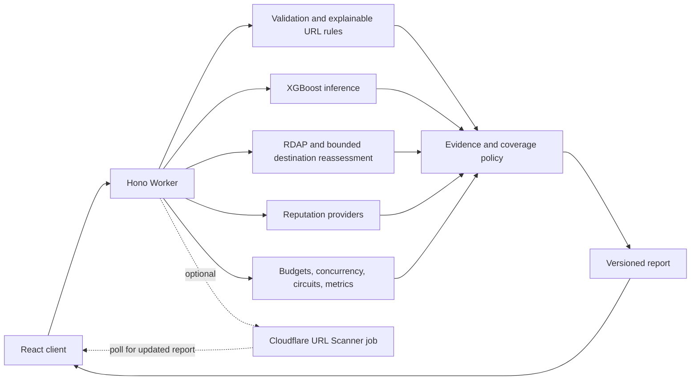

# phishX

### Understand a URL's threat signals—not a made-up safety score.

**phishX** is a free, evidence-driven URL threat analysis app. It combines real XGBoost model output and explainable URL rules with optional reputation checks from Google Safe Browsing, URLhaus, VirusTotal, and Cloudflare URL Scanner.

The original animated background, typewriter/glitch heading, ASCII X and floating glass panels surround the audited scanner. Motion can be paused and respects reduced-motion settings. Gemini assistance is visible near the verdict with its actual completion or fallback status.

> **A missing detection is not proof of safety.** Every report distinguishes findings from gaps, errors, and pending checks. Model output is supporting evidence—not a verdict or a numerical probability that a site is safe.

[Open the app](https://phish-x.vercel.app) · [API](https://backend-worker.phish-x.workers.dev) · [API docs](docs/API.md) · [Deployment guide](docs/DEPLOYMENT.md)

---

## What makes a report useful

- **Evidence, not guesses.** Verdicts are tied to recorded findings, coverage, provider status, and observation time.
- **Uncertainty stays visible.** Errors never become clean findings; unresolved shorteners remain unverified; missing reports stay missing.
- **Explanations stay grounded.** Reasons come from recorded evidence. Optional Gemini can select evidence for deterministic explanations, but cannot change a verdict.
- **No false reassurance.** “No known threats detected” means just that—it does not establish that a URL is legitimate or safe.

### Verdicts at a glance

| Verdict | What it means |
| --- | --- |
| **Malicious URL** | Strong threat-intelligence evidence was found. Avoid interacting with the URL. |
| **Suspicious URL** | Deceptive URL structure, weaker or stale positive intelligence, or conflicting findings warrant caution. |
| **No known threats detected** | Sufficient fresh reputation checks found no known threat or warning. This is not a safety guarantee. |
| **Unable to determine** | Evidence is insufficient, unknown, unavailable, failed, or still pending. |

An ordinary `/login` path is not a phishing finding by itself. A raw GitHub Gist is not automatically malicious.

## How it works



The Worker calls fixed provider endpoints; it does not crawl submitted websites itself. Cloudflare can perform optional remote active inspection. Optional KV supports scoped caching and bounded scan jobs; a per-scan Durable Object coordinates canonical job state and cleanup. Browser history is optional and redacted.

| Area | Responsibility |
| --- | --- |
| `shared/scan.ts` | v2 types, verdict labels, runtime validation, and privacy helpers |
| `backend-worker/src/` | Validation, heuristics, provider adapters, policy, caching/jobs, and routes |
| `frontend/src/` | Scanner, evidence report, coverage, domain metadata, and history |
| `frontend/test/`, `tests/` | Component/workflow and shared contract/privacy regressions |
| `frontend/e2e/` | Controlled browser tests with mocked API responses |
| `ml/`, `model/` | Reproducible training, native/edge parity, held-out evaluation, and model artifacts |
| `ops/`, `scripts/` | Aggregate monitoring, tested alerts, and real secret/artifact checks |
| `.planning/` | Audit-derived requirements, plan review, and verification records |
| `repo/` | Archived research; never loaded by the production scanner |

## Get started

### Requirements

- **Node.js 22.12 or later** (Node 24 is the development and CI default; see `.nvmrc`)
- **PowerShell** for the commands below

### Install

Install each app from its lockfile and create local environment files:

```powershell
npm ci --prefix backend-worker
npm ci --prefix frontend
Copy-Item backend-worker/.dev.vars.example backend-worker/.dev.vars
Copy-Item frontend/.env.example frontend/.env
```

### Run locally

Start the API and web app in separate terminals:

```powershell
npm run dev:api
```

```powershell
npm run dev:web
```

By default, the API is at `http://localhost:8787` and Vite is at `http://localhost:5173`. Set `VITE_API_URL` to change the API target; it is embedded at **build time**.

No provider key is needed to start development. Without reputation credentials, ordinary URLs return **Unable to determine**; suspicious structures can still produce explainable warnings. Health checks confirm API reachability, not provider health.

## Configuration

| Binding | Purpose |
| --- | --- |
| `GOOGLE_SAFE_BROWSING_API_KEY` | Independently configured Safe Browsing v5 reputation |
| `URLHAUS_API_KEY` | Malware-distribution lookup |
| `VIRUSTOTAL_API_KEY` | URL intelligence and actual domain metadata |
| `CLOUDFLARE_ACCOUNT_ID`, `CLOUDFLARE_API_TOKEN` | URL Scanner v2; token requires Scanner read/write permissions |
| `SCAN_CACHE` | Optional KV for reports and active-scan jobs |
| `ALLOWED_ORIGINS` | Comma-separated list of exact permitted frontend origins |
| `CACHE_CONFIG_VERSION` | Operator-controlled cache generation when provider configuration changes |
| `SCAN_RATE_LIMITER`, `POLL_RATE_LIMITER` | Managed scan-creation and poll rate-limit bindings in Wrangler |
| `SCAN_COORDINATOR`, `CLIENT_ID_SECRET` | Durable Object budgets, concurrency, and privacy-safe client identity |
| `METRICS_TOKEN` | Independent bearer token for aggregate metrics |
| `GEMINI_ENABLED`, `GEMINI_API_KEY`, `GEMINI_MODEL` | Bounded evidence selection; enabled in production, with explicit success/fallback status |

Managed limiters and production coordination are required for scan routes; missing infrastructure fails closed with HTTP 503. Follow `.dev.vars.example` for localhost development. Local Wrangler provides configured bindings. KV is optional: reputation and heuristic results still work without it, but Cloudflare scan jobs do not. Store production credentials as Cloudflare secrets. A Gemini key does not replace a Safe Browsing key.

> **Provider terms:** Google Safe Browsing is intended for non-commercial use. Before commercial deployment, evaluate [Google Web Risk](https://cloud.google.com/web-risk) or another suitable licensed alternative. Review every provider's terms and quotas.

## Verify changes

Run the project checks:

```powershell
npm run check
```

This runs backend type checking, frontend lint, shared/backend/frontend tests, and a production build. Useful individual commands include:

```powershell
npm run test:contract
npm run test:api
npm run test:web
npm run lint
npm run build
```

Run controlled browser tests with:

```powershell
cd frontend
npx playwright install chromium
npm run test:e2e
```

Tests use synthetic fixtures and do not call live scanners. The verification records in `.planning/phases/02-complete-audit/` document expanded checks and live-provider observations; `phase01` records the earlier baseline. Mocked tests do not prove live account permissions or detection accuracy.

For dependency, model, secret, and operations checks:

```powershell
npm audit --prefix frontend
npm audit --prefix backend-worker
npm run test:model
npm run scan:secrets
npm run check:ops
```

CI gates full dependency trees, model parity, real secret scanning, and alert rules. Evaluate development-tool advisories separately from shipped code; an audit pass is not a security certification.

## Limitations and research

No held-out benchmark establishes that phishX outperforms SENTINEL-X or another scanner. The comparison audit supplied requirements, not comparative detection measurements. URLhaus focuses on malware distribution, not all phishing. VirusTotal provides historical vendor intelligence, not fresh independent scans of every submitted URL. Explainable heuristics are not calibrated probabilities.

The new model has an executed temporal/domain-disjoint held-out evaluation, with documented false positives and substantial false negatives, in `model/`. Archived notebook accuracy does not describe this scanner. [Research limitations](docs/RESEARCH.md) cover duplicate rows, leakage risk, extractor defects, and environment gaps. Newly created, targeted, compromised, or cloaked sites can evade reputation checks and URL-only analysis.

**A report says “No known threats detected”—never “safe to visit.”**

## Docs and operations

- [API v2](docs/API.md)
- [Privacy and retention](docs/PRIVACY.md)
- [Threat model](docs/THREAT-MODEL.md)
- [Deployment](docs/DEPLOYMENT.md)
- [Operations](docs/OPERATIONS.md)
- [Technical audit](docs/TECHNICAL-AUDIT.md)
- [Audit traceability](docs/AUDIT-TRACEABILITY.md)
- [Research limitations](docs/RESEARCH.md)

A [free GitHub Actions availability monitor](docs/FREE-MONITORING.md) is prepared and live-tested. Source publication, a repository metrics secret, and verified notification delivery are still required; a temporary successful Prometheus scrape does not establish ongoing alerting.

## Credits and license

Historical research was adapted from [Shreya Gopal's project](https://github.com/shreyagopal/Phishing-Website-Detection-by-Machine-Learning-Techniques). phishX is licensed under MIT; see [LICENSE](LICENSE).

Unicode confusables carry their [Unicode V3 notice](backend-worker/src/data/UNICODE-LICENSE.txt). Training datasets and model derivatives have separate [attribution and terms](model/LICENSE-DATA.md); the code's MIT license does not replace those terms.
