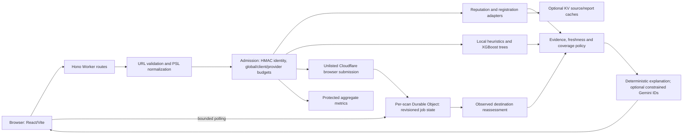

# phishX technical audit and implementation map

Date: 3 November 2026. Scope: the entire active application plus the supplied full audit. The detailed concern-by-concern mapping is [AUDIT-TRACEABILITY.md](AUDIT-TRACEABILITY.md); executed commands and hosted evidence are under `.planning/phases/02-complete-audit/`. Findings below distinguish observed implementation from remaining operational/research limits.

## Purpose and requirements

phishX is a free educational URL threat scanner. Its core requirement is to explain what evidence exists without presenting missing evidence as safety. It combines current external reputation, optional remote browser observations, bounded domain/impersonation rules, registration context and a genuine URL-only XGBoost model. It does not crawl arbitrary targets itself or promise that a website is safe.

The authoritative outcomes are malicious, suspicious, no known threats detected, and unable to determine. Source failure, pending work, unknown intelligence and stale negatives are separate states. Local heuristic/model negatives never establish remote coverage. Explicit consent is required before sharing URLs with sensitive parameter keys/fragments; such checks cannot recognize all confidential content.

## Architecture and relationships

The implementation uses TypeScript/Hono on Cloudflare Workers with Node compatibility, React 19/Vite 7 and Tailwind on the frontend, `tldts` for PSL domains, `ipaddr.js` for address classification and versioned Unicode 18 confusables. Each application has its own npm lockfile; root scripts coordinate checks. The restored Three.js wave background and ASCII X load automatically on capable default-motion browsers, with system reduced-motion support and static fallbacks. Python/XGBoost/sklearn/NumPy/Pandas are training dependencies, not serving dependencies.

## Frontend

`frontend/src/App.jsx` owns user input, disclosure/consent, abortable requests, bounded job polling, current report, dialogs and opt-in history. `lib/api.js` sends HTTP requests and validates structural/temporal contracts through `shared/scan.ts`; legacy binary responses are rejected. `ResultsDashboard.jsx` presents the official verdict, actual registrable domain, reasons and true provider coverage. `AnalysisExtensions.jsx` renders model provenance, RDAP data, separate destination assessments and grounded explanations. `CloudflareDeepAnalysis.jsx` renders only actual browser observations.

There is no client-side router or account state store: this is one React application with conditional views/dialogs and component state. Browser history uses bounded/redacted localStorage rather than a backend user account. `Dialog.jsx` manages focus/trapping/restoration; expiry hooks neutralize stale clean reports when time passes or a tab resumes. Result announcements/focus, domain copying, mobile layout, reduced motion and offscreen/hidden animation pauses have automated coverage. Accessibility automation does not replace human assistive-technology review.

## Backend and API

`index.ts` owns exact-origin CORS, body limits, media validation, rate-limit admission, metrics authentication and redacted public errors. `url.ts` canonicalizes standard HTTP(S) URLs, rejects embedded credentials/control characters/prohibited hosts/IPs, preserves query/path and distinguishes explicit protocols from bare inputs requesting both HTTP and HTTPS.

`providers.ts` implements Google Safe Browsing v5 URL search with returned cache validity and a bounded live-protobuf decoder, authenticated URLhaus malware lookup, and historical VirusTotal URL/vendor/domain metadata. Provider echoes, when supplied, must match the requested URL. `cloudflare.ts` uses the v2 create/result API, unlisted visibility, fixed-endpoint public DNS preflight, task/target correlation, live lowercase/documented statuses and actual observations. `registration.ts` discovers HTTPS RDAP services from IANA and validates returned domain identity/dates. Registration age alone is informational.

`http.ts` bounds response bytes, per-provider timeouts, selective idempotent retry/backoff and whole-scan cancellation. It uses Workers-supported manual redirect handling and rejects upstream redirects; credentials never follow another host. `control.ts` carries request context/deadline/resources with AsyncLocalStorage. The named admission instance of `ScanCoordinator` serializes client/global/provider budgets, leases, circuits and aggregate metrics. Trusted edge identity is HMAC-hashed with an independent secret and rotated daily; forwarded identity is not accepted. Missing required production protection fails closed.

`evidence.ts` expires negatives and computes the official result. One strong attributed threat cannot be outvoted by silence. A clean conclusion needs at least two fresh reputation sources covering every requested protocol, no warnings, and no pending investigation. `destinations.ts` separately checks up to four observed destinations without recursive crawling. Unresolved shorteners, excess redirects and incomplete followups prevent unsupported reassurance. `explanation.ts` optionally lets Gemini select bounded existing evidence IDs; displayed descriptions and verdict remain deterministic.

Public routes are `POST /api/verify`, `GET /api/scans/:id`, `GET /api/ping` and protected `GET /api/metrics`. There is no user-account authentication/authorization system. CORS is a browser boundary, not authentication. Poll IDs are unpredictable temporary read capabilities; the metrics endpoint has a separate bearer secret and bounded aggregate output.

## Storage, models and migrations

There is no application SQL user database, ORM or relational account schema. SQLite-backed Durable Objects use the platform key/value API. One object stores admission windows, expiring concurrency leases, circuit state and counters. Separate per-scan instances store canonical `ScanJob` records: report, pending provider IDs, fixed deadline/cadence, revision and active lease. `job-state.ts` validates records. Atomic revision handling prevents stale concurrent polls from erasing stronger warnings. Native alarms delete job payloads at the fixed deadline plus sixty seconds. Job objects may contain submitted URLs; admission/metrics state does not.

`storage.ts` hashes cache keys by policy, scope, configuration generation and capabilities. Optional KV holds source/report caches and submission reservations. Full reports require complete current remote checks and expire within 120 seconds or earlier source expiry; GSB caching honors its returned validity, bounded to 24 hours. Active jobs last 180 seconds with 240 second retention. KV-only job storage is an uncoordinated local-test fallback, not production authority. Wrangler's `v1-control` migration provisions the SQLite class; it does not migrate a legacy relational database.

The active model is `xgb-url-2026-11-03-v2`: 160 genuine depth 4 XGBoost trees, 69 shared protocol-invariant features and a 90,424 byte edge artifact. `ml/features.mjs` runs in both acquisition/training projection and serving. Native JSON/compact trees replace pickle deserialization. Artifact graph/schema checks and CI hashes/native parity protect serving consistency. `repo/` is preserved historical research and is never loaded by production.

## End-to-end workflows

1. The user submits a URL; the browser discloses sharing, checks consent and sends the request. The server independently validates input and obtains protected admission/concurrency capacity.
2. The Worker checks policy/scope/config-aware cache, then concurrently gathers configured reputation, RDAP and optional Cloudflare submissions. Local heuristics and actual model inference add attributed supporting evidence.
3. The server computes coverage/verdict and an evidence-grounded explanation, validates the complete report, stores eligible cache/job state and returns it. Failed sources remain explicit and do not count as clean.
4. For active inspection, the browser polls only the returned same-job path after the stated cadence. The Worker reads strong canonical job state, fetches actual provider results, reassesses discovered destinations, resolves concurrent revisions, preserves warnings and returns a validated current report.
5. Cancellation stops client requests/polling but cannot undo accepted remote work. Expiry, refresh and history remain explicit. Protected aggregate metrics feed optional Prometheus/Grafana monitoring without URL/client labels.

## Development and deployment

Use Node 22.12+ (CI/development 24), `npm ci --prefix backend-worker`, and `npm ci --prefix frontend`. Development commands are `npm run dev:api` and `npm run dev:web`. Provider keys are optional locally; production requires managed limiters, coordination and independent privacy/metrics secrets. `.dev.vars.example` documents local names; production secrets belong on the Worker. `VITE_API_URL` is public build-time configuration, never a provider secret.

`npm run check` runs typechecks, lint, contract/backend/frontend tests and build. Additional gates are Playwright/axe desktop/mobile tests, `npm run test:model`, Python pipeline tests, full npm audits, checksummed Gitleaks source/history scanning, real promtool syntax/behavior tests, Wrangler typegen/dry-run and `npm run benchmark:controlled`. CI and Dependabot cover ongoing verification.

`npm run package:web` builds public assets against the reviewed HTTPS API origin and creates ignored Vercel Build Output API v3 files. Hosting CSP/security headers live in `frontend/vercel.json`; `.vercelignore` excludes backend/research/data/secrets. Provider keys never enter frontend bundles. Cloudflare/Vercel CLIs and plugins are installed/authenticated user-wide; they are not runtime dependencies. Full release identifiers and public checks must be read from the phase verification rather than inferred from a successful build.

## Confirmed improvements and remaining limits

The binary consensus, fabricated telemetry, Gist malware override, arbitrary safety score, fake XGBoost branding, stale/failed-clean behavior, missing validation/timeouts, broad CORS and starter-only tests were replaced. Actual live checks also caught and corrected unsupported Worker redirect mode, Safe Browsing protobuf responses, lowercase Cloudflare statuses, normal 404 circuit behavior, unresolved shorteners, redirect truncation/staleness, failed registration labeling and distributed poll overwrites.

The fixed historical test has 103,379 URLs and zero pairwise registrable-domain overlap. Model precision is 99.148%, recall 48.657%, FNR 51.343%, FPR 0.4293%, AUROC 0.95607 at the validation-selected threshold. These are dataset-specific warning measurements. At a hypothetical 0.1% phishing prevalence, implied precision is only 10.19%. The benign raw-Gist control still produces a disclosed model false positive. v1's test was viewed before the protocol shortcut correction; v2 is a second fixed-test evaluation, not a new untouched benchmark. Cross-domain campaign/template isolation and future traffic calibration are not proven. A model negative never establishes safety.

Other residuals are bounded brand coverage, newly created/compromised/cloaked sites, provider retention and outages, provider-side DNS/redirect behavior, the restored decorative 3D download. The Worker does not control Cloudflare's browser resolver, cannot guarantee third-party deletion, and does not claim superiority over SENTINEL-X.

The matching Worker and frontend are deployed to `backend-worker.phish-x.workers.dev` and `phish-x.vercel.app`. Actual hosted/provider, desktop/mobile, security-header and metrics checks passed; phase02 verification records release identifiers and limits. The initial source release was published as `dc1b315`; subsequent visual/Gemini restoration is recorded under `.planning/quick/261103-ltf-restore-original-animated-ui-and-visible/`.

Repository monitoring/alert rules are implemented and tested. A real temporary Prometheus process scraped production with all six rules loaded, then stopped. A free scheduled GitHub Actions availability monitor is prepared, regression-tested and live-tested; its repository metrics secret and personal failure-notification preferences remain required. See [FREE-MONITORING.md](FREE-MONITORING.md). Persistent provider-rate alerting, actual delivery, provider billing alerts, secret rotation policy enforcement and platform log-retention settings remain operational work. Multi-region load/availability and human assistive-technology behavior are not certified by fixture tests.
